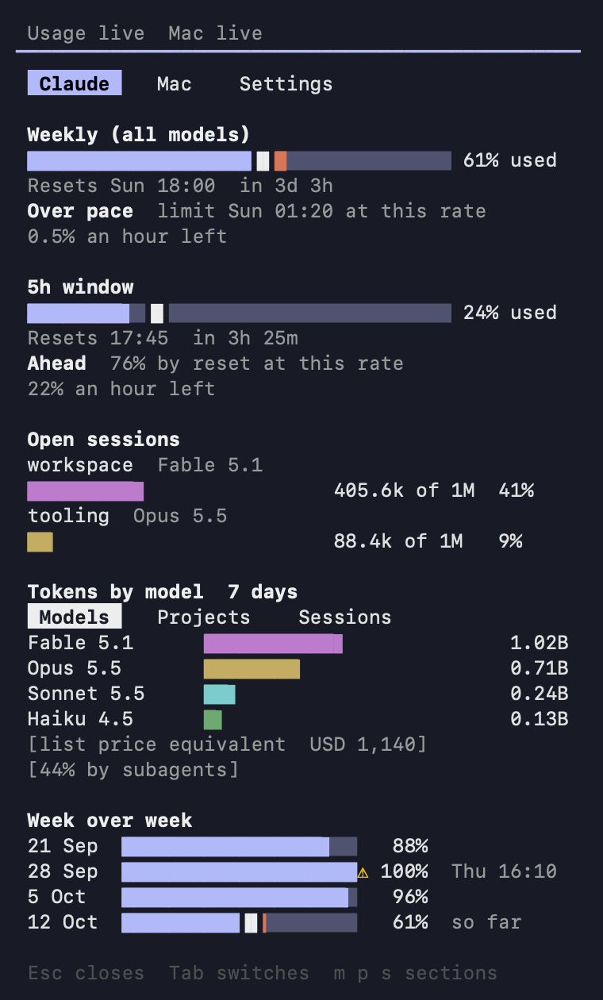

# tokenpanda

tokenpanda is a macOS menu bar app that tells you how much of your Claude plan is left and whether you are ahead of the clock or behind it. It reads Claude Code's own status line feed and the transcripts already on your Mac, makes no network calls, and shows the Mac's CPU, memory and battery on a second tab.



Every time I looked at a usage percentage I did the same sum in my head: it is Thursday afternoon, 61 percent is gone, the week resets Sunday evening, is that a lot? So the popover says it in words. Each window gets a bar with a tick where the clock stands, a status word (Ahead, On pace, Over pace), the clock time the limit lands if you keep going like this, and what is left per hour.

## Install and build

Download `tokenpanda-<version>.zip` and `tokenpanda-<version>.zip.sha256` from the [releases page](https://github.com/tokenpandadev/tokenpanda/releases), then check the zip in the folder you saved both to:

```sh
shasum -a 256 -c tokenpanda-<version>.zip.sha256
```

It should print `OK`. Unzip it and move `tokenpanda.app` to Applications.

The app is signed ad hoc, not notarised, so macOS blocks it the first time. Try to open it, then open System Settings, click Privacy & Security, scroll down and click Open Anyway. The warning comes back once more; click Open. From then on it opens normally. On macOS 26 and later, if the item does not show in the menu bar, allow it in System Settings under Menu Bar.

With Homebrew:

```sh
brew install tokenpandadev/tap/tokenpanda
```

The Open Anyway step applies after a Homebrew install too.

On first launch the Claude tab offers one button, Install the status line hook. Click it, start a Claude Code session, and the figures arrive after the first reply.

To build from source you need a Mac on macOS 14 or later with the Command Line Tools or Xcode. Swift 6 is required; nothing else is downloaded.

```sh
swift build
swift test -Xswiftc -plugin-path -Xswiftc /Library/Developer/CommandLineTools/usr/lib/swift/host/plugins/testing
scripts/build-app.sh 0.1.0
open build/tokenpanda.app
```

The plugin flag is for the Command Line Tools, which ship swift-testing without telling the compiler where its macro plugin lives. With Xcode selected, plain `swift test` works. `scripts/build-app.sh` builds the release binary, assembles `build/tokenpanda.app`, signs it ad hoc, and writes `build/tokenpanda-<version>.zip` with its SHA-256. A debug build also takes `--snapshot <folder>`, which renders every tab and state of the sample data to PNG.

The documentation is plain HTML in `docs/`: an overview, the style guide, the spec and the privacy page.

## How it reads your usage

Claude Code runs a status line command after each reply and hands it a JSON object that includes your plan windows: `rate_limits.five_hour` and `rate_limits.seven_day`, each with the used percentage and the reset time. When you click Install, tokenpanda adds one `statusLine` entry to `~/.claude/settings.json` that points at a small shell script. The script copies that object to a file in `~/Library/Application Support/dev.tokenpanda.app` and passes it on to the status line you already had, so yours keeps working. Clicking "Remove the status line entry" in Settings puts your previous entry back exactly. Between sessions the app shows the last figures with the time they were read.

Tokens per model, project and session come from the transcripts Claude Code keeps in `~/.claude/projects`. The cost figure is tokens times the published list prices, so it is labelled list price equivalent, not money spent.

The rules it keeps:

- No network calls at all: no analytics, no update check, no price fetch.
- Plan figures come only from the documented status line feed. No Keychain, no token, no private endpoint.
- From each transcript line it keeps the time, ids, model, working directory name and token counts, never what you wrote or what came back.
- It never opens `memory/` or `tool-results/`, and touches `settings.json` only when you click, and only its `statusLine` key.
- Nothing leaves your Mac. The [privacy page](docs/privacy.html) names every file it reads and writes.

Anthropic documents the status line feed as input for any script you configure. It has written nothing either way about a local tool reading the transcripts on your own Mac. That is silence, not permission, and I would rather say so than claim more.

Licence: MIT, see [LICENSE](LICENSE). Changes per version are in [CHANGELOG.md](CHANGELOG.md).

If tokenpanda saves you a few sums a day, you can support it through [GitHub Sponsors](https://github.com/sponsors/tokenpandadev) or [Buy Me a Coffee](https://buymeacoffee.com/tokenpanda).
